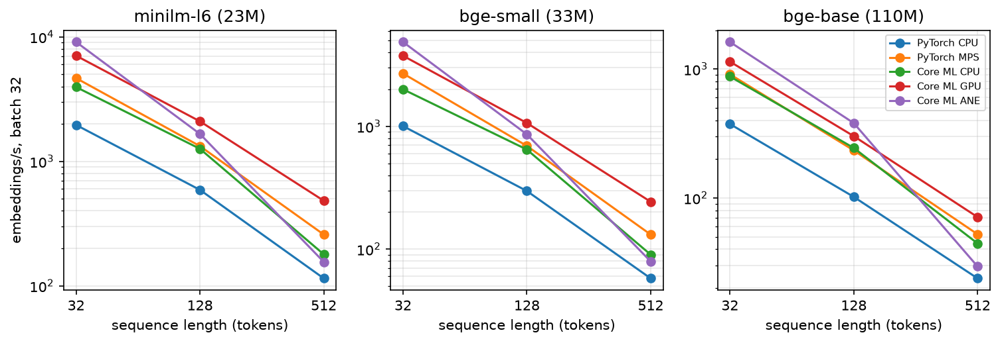

# Text embeddings on the Apple Neural Engine

Code and measurement data for the paper

> S. Davshits, S. Loseva. *Latency, energy, and fidelity of text embedding
> inference on the Apple Neural Engine.* PIERE 2026 (in press).

Six open sentence-embedding models are run on an Apple M4 Pro through five
execution paths, at three sequence lengths and two batch sizes. For each of the
180 configurations the benchmark records latency, throughput and
processor-domain energy. It also checks the numerical agreement with an fp32
reference, retrieval quality on BEIR SciFact and the planned operation
placement from the Core ML compute plan.

## Main results

Net energy per 1000 embeddings (J), batch 32, 128 tokens, median of three sessions:

| model       | PyTorch CPU | PyTorch MPS | Core ML CPU | Core ML GPU | Core ML ANE |
|-------------|------------:|------------:|------------:|------------:|------------:|
| MiniLM-L6   | 28.1  | 20.2  | 10.0 | 12.2 | **2.9**  |
| bge-small   | 56.3  | 39.8  | 19.6 | 24.3 | **5.6**  |
| MiniLM-L12  | 57.3  | 39.6  | 19.8 | 24.5 | **5.6**  |
| bge-base    | 122.3 | 131.6 | 50.9 | 95.8 | **17.1** |
| e5-base     | 121.9 | 130.6 | 50.6 | 94.6 | **17.3** |
| mE5-small   | 56.3  | 39.3  | 19.4 | 24.5 | **5.5**  |

- The fastest path depends on the workload. At batch 1 the ANE has the lowest
  latency for 32 and 128 tokens and the Core ML GPU path for 512 tokens. At
  batch 32 and 128 tokens the Core ML GPU path leads for the four smaller
  models and the ANE leads for bge-base and e5-base.
- The ANE uses the least net energy in all 36 model, batch and length
  combinations. At batch 32 the best non-ANE backend (always Core ML CPU) uses
  2.4 to 3.5 times as much; at batch 1, 1.8 to 3.4 times.
- fp16 on the ANE changes a few individual rankings (overlap@10 with the fp32
  top 10 is 0.974 to 0.996). Aggregate nDCG@10 stays within 0.0015 of the fp32
  reference (largest drop 0.0002) and Recall@100 is unchanged.
- Length buckets instead of padding to 512 tokens raise indexing throughput by
  9 to 26 % on the SciFact corpus. This run (`r1`) preceded the readiness
  probe: its CPU and GPU paths ran at 0.48–0.66 of their grid throughput, so
  the gains compare within a backend, not across backends.

All 180 configurations are in [`results/processed/summary.csv`](results/processed/summary.csv).



## Execution paths

| key      | engine   | device / compute units | precision |
|----------|----------|------------------------|-----------|
| `pt-cpu` | PyTorch  | CPU                    | fp32 (reference) |
| `pt-mps` | PyTorch  | GPU via MPS            | fp32 |
| `cm-cpu` | Core ML  | `CPU_ONLY`             | fp16 |
| `cm-gpu` | Core ML  | `CPU_AND_GPU`          | fp16 |
| `cm-ane` | Core ML  | `CPU_AND_NE`           | fp16 |

`cm-cpu-32`, `pt-mps-16` and `cm-all` are used only in the control session `c1`.

Pooling and L2 normalization are part of the traced graph, so every path runs
the same operation chain (`src/models.py`). Core ML packages are ML Programs
with static int32 input shapes, one per (batch, length), converted with
`minimum_deployment_target=macOS14`. With a macOS 15 target, Core ML Tools 9.0
emits a fused attention op that the ANE compiler rejects, and the model then
runs on the GPU (`src/convert.py`).

## Test system

| | |
|---|---|
| Machine | MacBook Pro, Apple M4 Pro (10P + 4E CPU cores, 20-core GPU, 16-core Neural Engine), 24 GB |
| OS | macOS 26.5.2, on mains power, Low Power Mode off |
| Software | Python 3.12.14, PyTorch 2.8.0, coremltools 9.0, Transformers 4.57.6 (see `requirements.txt`) |
| Models | Hugging Face snapshots recorded in `src/models.py` (revisions were not pinned during the run; these are the cached snapshots it used) |

## Repository layout

```
src/
  models.py      model registry and the embedding module (backbone + pooling + L2)
  convert.py     PyTorch -> Core ML conversion, static shapes
  backends.py    the five execution paths behind one encode() interface
  bench.py       measurement grid: warm-up, timed loop of at least 6 s, JSONL output
  power.py       powermetrics parsing and per-window energy
  probe.py       readiness probe against the reference session
  placement.py   planned per-operation device from MLComputePlan
  fidelity.py    cosine to fp32, nDCG@10, Recall@100, overlap@10 on SciFact
  realistic.py   corpus indexing: padding to 512 vs. length buckets
  smoke.py       quick check that the ANE path works
  analyze.py     aggregation, tables, figures
configs/         measurement grids (core, control, smoke)
scripts/         run_session.sh (one session), reproduce_all.sh (full program)
results/
  raw/<session>/bench.jsonl        measurements as recorded
  raw/<session>/bench_power.jsonl  the same with energy attached
  power_traces/power_<session>.csv.gz   parsed powermetrics samples
  processed/     summary.csv, measurements.csv, tables, fidelity, placement
figures/
paper/           the published paper (added after publication)
```

## Sessions

| session | content | used in the paper |
|---------|---------|-------------------|
| `s1` | core grid, seed 1; reference for the probe | yes |
| `s2` | core grid, seed 2 | **no**: a powermetrics process left over from `s1` was still running |
| `s3` | core grid, seed 3; run before the probe existed, throughput ratio to `s1` 0.998–1.000 per backend | yes |
| `s4` | core grid, seed 4; probe ratio 0.990 (`results/raw/s4/probe.txt`) | yes |
| `c1` | control backends (fp32 Core ML CPU, fp16 MPS, `ALL` policy) | yes |
| `r1` | SciFact indexing with and without length buckets | yes |

Each session starts with 60 s of idle time, which gives the idle power per
domain. Configurations run in a seeded random order with 30 s pauses between them.
`scripts/run_session.sh` refuses to start when the probe ratio is below 0.95;
if the probe itself fails to run, the script prints a warning and continues.

## How energy is computed

`sudo powermetrics --samplers cpu_power,gpu_power,ane_power,thermal -i 200`
reports CPU, GPU and ANE power about every 200 ms. Its timestamps have
one-second resolution, so the k samples that share a stamp are placed at
stamp + (j+1)/k (`src/power.py`). For each measurement window and domain d:

```
E_d   = sum over samples of P_d * overlap with the window
net   = sum_d max(E_d - B_d * T, 0)       B_d: mean idle power, T: window length
J/1k  = 1000 * net / embeddings in the window
```

Three windows contain no power samples. Their energy is treated as missing.
These are processor-domain values reported by macOS, not wall-socket power.

## Reproducing

Tables and figures from the archived data (no inference, a few seconds):

```bash
python3.12 -m venv .venv
.venv/bin/pip install -r requirements.txt
.venv/bin/python -m src.analyze --sessions s1 s3 s4 --figures
```

`src.power` recomputes the energy values from `results/power_traces/` when the
raw powermetrics logs (about 2 GB, not included) are absent:

```bash
.venv/bin/python -m src.power --session s3
```

A new measurement session needs an idle Mac on mains power and `sudo` for
powermetrics. One session takes about 2 hours:

```bash
.venv/bin/python -m src.convert --models minilm-l6 minilm-l12 bge-small bge-base e5-base me5-small \
    --batches 1 32 --lengths 32 128 512
.venv/bin/python -m src.smoke
scripts/run_session.sh s5 configs/core.yaml 5
```

`scripts/reproduce_all.sh` lists the full sequence used for the paper.

## Citation

See [`CITATION.cff`](CITATION.cff). The paper reference will be updated after publication.

## License

MIT, see [`LICENSE`](LICENSE). Model weights and the SciFact dataset are
downloaded from Hugging Face and are covered by their own licenses.
